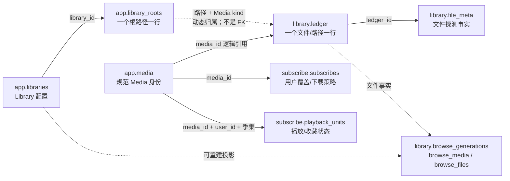

# 当前数据库设计与全量数据字典

基线：`main@2c3a5c7`。这是**当前实现快照**，不是数据库重设计方案，也不包括 stash 中未合入的 DB-07。本文只盘点 schema 与查询关系，不授权迁移、清库或真实设备测试。

## 1. 如何核实

在独立临时目录调用当前代码的 `store::Store::open`、`jobs::Queue::open`、`media::fanart::FanartClient::new`，执行真实初始化/迁移，再从 `sqlite_schema`、`PRAGMA table_xinfo`、`index_list`、`index_info`、`foreign_key_list` 提取表、字段、键、默认值、索引、外键与触发器。没有连接生产数据库，没有执行外部 Metadata source 请求。

- 覆盖 **6 个 DB 文件，60 张代码创建的表、467 个字段**；不收录 SQLite 自动生成的内部表。`_browse_changes`、`_read_revisions` 虽以下划线开头，仍是项目代码创建的表，保留在字典中。
- 提取的当前 schema 有 **59 个显式命名索引**、**2 条显式外键**、**52 个触发器**。主键/UNIQUE 自动索引另列在各表约束中。
- 表归属必须以连接与迁移为准，不能只按表名猜文件：**Library 配置在 `app.db`，文件台账在 `library.db`，Subscribe 和 Playback 在 `subscribe.db`**。
- 来源：[Store 打开/迁移路由](../../crates/store/src/open.rs)、[Store schema](../../crates/store/src/schema.rs)、[基础 DDL](../../crates/store/src/schema/tables.rs)、[Jobs migrate](../../crates/jobs/src/store.rs)、[fanart/cache 初始化](../../crates/media/src/cache.rs)。
- 现有实例可能仍有额外历史表/人为添加表，或旧版本的列约束。此文描述**当前程序初始化的新实例**，并结合迁移说明旧库差异；不声称已扫描你的真实数据文件。

## 2. 六个文件与导航

| 文件 | 当前 `user_version` | 代码创建的表数 | 主要职责 | 完整字段字典 |
|---|---:|---:|---|---|
| `app.db` | 7 | 18 | User/凭证、Media 身份、Library/根配置、Site/Downloader/Filter、集合、设置、删除流程 | [app.md](app.md) |
| `library.db` | 17 | 24 | ledger、文件 probe 事实、标记/指纹、扫描和章节义务、浏览投影与失效游标 | [library.md](library.md) |
| `catalog.db` | 3 | 3 | Metadata source 原始响应缓存及其修订/journal | [catalog.md](catalog.md) |
| `subscribe.db` | 8 | 10 | Subscribe 策略/槽位/待下载事实；用户 Playback 单元、会话、历史、QoE | [subscribe.md](subscribe.md) |
| `jobs.db` | 0 | 4 | 通用 Job 定义、排队/执行/重试、变更计数与保留游标 | [jobs.md](jobs.md) |
| `fanart.db` | 0 | 1 | fanart.tv 图片元数据缓存（按需创建） | [fanart.md](fanart.md) |

`jobs.db` / `fanart.db` 的版本 0 是实测 `PRAGMA user_version`，不表示未初始化；这两个初始化器使用幂等建表而没有设置 Store 那套版本常量。

默认路径为数据目录下的同名文件。`Store::open_at` 允许 `app.db` 使用调用者指定路径，另三个 Store 文件仍在数据目录。`jobs.db` 由 `ApiState` 初始化的 Queue 打开；`fanart.db` 在 fanart 路径按需打开。

### 2.1 表归属速查

- **app.db**：`users`、`user_tokens`、`playback_device_credentials`、`media`、`sites`、`downloaders`、`filters`、`libraries`、`library_roots`、`library_removals`、`library_removal_roots`、`naming_templates`、`collections`、`collection_items`、`settings`、`search_snapshots`、`_read_revisions`、`_browse_changes`。
- **library.db**：`ledger`、`scrape_sidecars`、`unidentified`、`file_meta`、`media_markers`、`fingerprint_cache`、`fingerprint_samples`、`fingerprint_season_models`、`fingerprint_model_members`、`fingerprint_attempts`、`probe_jobs`、`probe_job_units`、`probe_stage_state`、`probe_season_comparison_history`、`ledger_probe_obligations`、`chapter_frame_tasks`、`scan_operations`、`scan_seen`、`browse_generations`、`browse_files`、`browse_media`、`browse_change_cursors`、`_read_revisions`、`_browse_changes`。
- **catalog.db**：`catalog_cache`、`_read_revisions`、`_browse_changes`。
- **subscribe.db**：`subscribes`、`subscribe_facts`、`subscribe_wanted`、`pending_downloads`、`playback_units`、`playback_sessions`、`playback_session_ids`、`playback_logs`、`playback_metrics`、`_read_revisions`。
- **jobs.db**：`job_defs`、`jobs`、`retention_cursors`、`job_change_state`。
- **fanart.db**：`catalog_cache`。

## 3. 核心模型：身份、文件、库配置不是同一件事



图中的箭头大多为**逻辑关系**，不是 SQLite 已声明的外键。不能把图当作已有级联约束。

### 3.1 现有 Library 归属规则

实现：[library_ownership.rs](../../crates/store/src/library_ownership.rs)。

1. 读取 Library 配置、根列表及删除/冻结边界。
2. 对一条文件路径，按 **Media kind 相同**的根做 `Path::starts_with` 组件级匹配。
3. 最深根唯一命中则归该 Library；不同 Library 的根在相同最深深度并列则归属不明确。
4. 完全无根命中时，普通读取可以回退到该 kind 的默认 Library；**歧义不做默认回退**。
5. 删除/Transfer 等副作用另有严格实时归属校验；不能把普通浏览的默认回退当作删除授权。

**候选查询 ≠ 最终归属**：[browse_reads.rs](../../crates/store/src/browse_reads.rs) 用路径范围 SQL 先取候选；嵌套子库行可能仍是父库候选，调用者随后用 `owner()` 和可见性过滤。`ledger_path_idx(path)` 已存在，`ledger_media_id_idx(media_id)` 也已存在；不能说所有路径范围查询都无法用索引。**默认库的“不匹配任何同 kind 根”分支仍可能扫描大量行**，这是 DB-07 尚待评审的热点。

当前 `ledger` **没有 `library_id` 或 `kind` 列**；`root_id` 虽存在，但未成为可靠回填的持久归属。故不能直接写 `ledger.root_id = libraries.id`，也不能假定 `ledger.root_id = library_roots.id` 已覆盖全部数据。

### 3.2 权威状态、投影、缓存

| 层次 | 表/文件 | 设计时必须保留的区别 |
|---|---|---|
| 业务身份与配置 | app.db 大部分表、subscribes/用户 Playback | 不可按缓存清空 |
| 权威文件台账 | ledger + Transfer/扫描义务 | 删除/重命名影响实际业务；不是 browse 缓存 |
| 可重建浏览投影 | browse_generations/media/files | 先校验代次、scope、dirty token 再读，不能只看表有数据 |
| 外部响应缓存 | catalog.db.catalog_cache、fanart.db.catalog_cache | 可按策略重抓，但缓存 body 不等于 Media 身份 |
| 通用执行状态 | jobs.db | 定义/在途/重试是事实，不是只丢历史的可弃缓存 |
| 专用文件工作状态 | probe_jobs/units/stage_state、chapter_frame_tasks、scan_operations | 与通用 Job 不同粒度；需要恢复/幂等/清理保护 |

## 4. 字段字典的阅读规则

每个 DB 的子文档逐表列出**所有物理列**：SQLite 类型、复合主键顺位、`NOT NULL` 声明、`DEFAULT`、字段作用，以及索引/外键/触发器。

- `NOT NULL 声明` 是 `PRAGMA table_xinfo.notnull` 的实测值。SQLite 的普通 rowid 表上，`TEXT PRIMARY KEY` 与显式 `NOT NULL` 不是同一声明；本文不擅自把主键列的 notnull 标记改成 1。`INTEGER PRIMARY KEY` 则有特殊 rowid 语义。
- `INTEGER` 中的布尔开关通常用 0/1；状态、枚举、UUID 多为 `TEXT`，但没有因此自动获得 `CHECK` 或 FK。
- 时间单位混合存在：`*_ms` 通常为毫秒，`added_at_ns` 为纳秒，Playback 的 `updated_at/favorite_at`、Job 的 `run_after/finished_at`、cache 的 `fetched_at/expires_at` 为 Unix 秒；Subscribe/集合的部分时间则为 RFC3339 UTC。**不要用统一的“所有 INTEGER 时间都是毫秒”解释。**
- `NULL` 与 0/-1 含义依表：`playback_units` 的 -1 是作用域哨兵，真实 TV 的 0 季/0 集不能误作电影兼容行；旧库可能有 movie `(0,0)` 状态。
- JSON 列不是 SQL 的规范化关系：成员数组、Filter atoms、采样计划、投影 facts 与候选都有各自版本/结构。字段含义见各表附注。
- 外部凭证字段只记名字/用途，不展示实例数据；User 密码散列和 Downloader 连接密码是不同性质的字段。

## 5. 目前确实存在的同库联合查询

这里的“已有”是源码中有对应 SQL 或同库关联子查询，并非只因字段看起来相似。

| 场景 | 表与连接键 | 现有方式 | 代码证据 |
|---|---|---|---|
| token 鉴权 | users.id = user_tokens.user_id | `JOIN` + token/TTL/User enabled 检查 | [users.rs](../../crates/store/src/users.rs) `user_by_token` |
| 设备凭证验证/撤销 | playback_device_credentials.token = user_tokens.token 且 user_id 相同 | `JOIN`，还排除 settings 中的特殊凭证 | [playback_devices.rs](../../crates/store/src/playback_devices.rs) |
| 默认 Library 的主根 | library_roots.library_id = libraries.id | `JOIN` + kind/is_default | [library.rs](../../crates/store/src/library.rs) `library_root` |
| probe 窗口领取/快照 | probe_job_units.job_id = probe_jobs.id | `JOIN` + 父/子状态与派发 stage 过滤 | [probe_dispatch.rs](../../crates/store/src/probe_dispatch.rs) |
| 用户锁定标记 | ledger.media_id = media_markers.media_id，季集需按现有 COALESCE 规则 | `JOIN` | [library/markers.rs](../../crates/store/src/library/markers.rs) |
| 只分页有文件的 Media | browse_media 与 browse_files 按 (library_id, media_id) | `EXISTS` 半连接，避免一部作品多文件放大分页条数 | [browse_pages.rs](../../crates/store/src/browse_pages.rs) |
| scan 已见路径是否仍有台账 | scan_seen.path = ledger.path | `EXISTS` / 标量子查询 | [scan_seen.rs](../../crates/store/src/scan_seen.rs) |
| 删除文件后的 probe 退休/计数 | probe_job_units.ledger_id = ledger.id；probe_job_units.job_id = probe_jobs.id | `NOT EXISTS` 与同库事务计数对账 | [probe_unit_retirement.rs](../../crates/store/src/ledger_cleanup/probe_unit_retirement.rs) |
| 历史清理的引用保护 | fingerprint_samples.captured_job_id、probe_stage_state.active_job_id、probe_job_units.job_id → probe_jobs.id | `EXISTS`，防止删在用/被引用 probe 历史 | [data_retention.rs](../../crates/store/src/data_retention.rs) |
| Job 调度与定义启用/并发 | jobs.def_id → job_defs.id | 领取逻辑读取定义；jobs 自关联检查活跃/历史 | [jobs/store.rs](../../crates/jobs/src/store.rs) |
| User 可见的历史/观看聚合 | playback_logs.media_id = TEMP.request_visible_media.id | `EXISTS` 半连接 | [watch_aggregate.rs](../../crates/store/src/playback/watch_aggregate.rs)、[log_scope.rs](../../crates/store/src/playback/log_scope.rs) |

### 5.1 两个可执行的同库示例

这两个例子与当前表结构一致；只描述查询，不要求新增接口。

```sql
-- app.db：Library 根列表（不是文件列表）
SELECT l.id AS library_id, l.name, l.kind, r.path, r.sort_order
FROM libraries AS l
LEFT JOIN library_roots AS r ON r.library_id = l.id
ORDER BY l.sort_order, l.name, r.sort_order, r.path;
```

```sql
-- library.db：活跃 probe 的待派发单元
SELECT j.id AS job_id, j.kind, u.ledger_id, u.stage, u.status
FROM probe_jobs AS j
JOIN probe_job_units AS u ON u.job_id = j.id
WHERE j.status IN ('queued', 'running') AND u.status = 'queued'
ORDER BY j.created_at_ms, j.id, u.ledger_id;
```

## 6. 当前跨 DB 是应用层拼接，不是已部署的跨库 JOIN

当前 `Store` 是四个独立 `rusqlite::Connection`；Queue/cache 另有自己的连接。源码盘点没有发现生产路径用 `ATTACH DATABASE` 执行业务跨文件 JOIN。跨文件没有 FK，现有连接上的事务也不自动覆盖其他文件。共享同一个 Rust `Store`/互斥锁不等于 SQLite 跨文件事务。

| 业务读取 | 关联表/键 | 当前组合方式与注意 |
|---|---|---|
| Library 文件列表/归属 | app.libraries / library_roots + app.media.kind + library.ledger.media_id/path | 先取 ownership 与台账，批量取 Media，再在应用层做 kind+路径归属及权限过滤 |
| Jellyfin 选择/重元数据 | library.ledger/file_meta/media_markers + app.media + subscribe.playback_units | `read_scope` / `collect_server_read` 读台账，`media_batch`、`playback_units_for_media` 定向批读，再轻筛/分页/重渲染；不是数据库一次 JOIN |
| Library 统计 | app Library 配置 + library.ledger + app.media + library.browse_* | 一次台账/Media 聚合 + 投影 totals，跨 await 还需 scope/代次/dirty 校验 |
| Subscribe 搜索前已拥有事实 | subscribe.subscribes/subscribe_facts + app.media/Library + library.ledger/质量 | `subscribe_library_snapshot` 在各连接读取事实与修订后拼接，不存在跨文件 FK 保护 |
| Downloader 提交/Transfer | subscribe.pending_downloads.torrent_json + app.downloaders/sites + library.ledger | 下载客户端 ID/来源可埋在 JSON；Transfer 后写台账与 Subscribe 槽位，跨库操作不等于一个原子 SQL 事务 |
| 观看历史列表 | subscribe.playback_logs/units + app.media + 当前 Library 可见性 | 先计算可见 Media 集合，装入 subscribe 连接 TEMP 表再聚合；详细 Media 展示另批读 |
| 通用 Job 关联业务 | jobs.jobs.payload/def_id + app/subscribe/library 相关对象 | payload 按 kind 解码包含业务 ID；不是裸 job_id 就能与 probe_jobs JOIN |
| Metadata source 补充资料 | app.media 的 tmdb_id 等 + catalog.catalog_cache(source,cache_key) | 缓存键按来源和请求路径构造；没有 cache.media_id 列，不是 `media.id = cache_key` |
| fanart 选图 | Media 外部 ID + fanart.catalog_cache | 独立 fanart key（含媒体类别/来源 id/凭证摘要）；不是 catalog.db 的同步镜像 |

代码入口：[read_snapshot.rs](../../crates/api/src/media_server_provider/read_snapshot.rs)、[selection/scope.rs](../../crates/api/src/media_server_provider/selection/scope.rs)、[library_statistics.rs](../../crates/api/src/library_statistics.rs)、[subscribe_library_snapshot.rs](../../crates/store/src/subscribe_library_snapshot.rs)、[enrichment.rs](../../crates/api/src/media_server_provider/enrichment.rs)、[media.rs](../../crates/store/src/media.rs)。

### 6.1 数据库评审时可考虑的关联（不是已实现的 SQL）

| 需求 | 自然关联键 | 现状限制/评审点 |
|---|---|---|
| 文件 + Media 名称/年份/外部 ID | ledger.media_id → media.id | 跨文件；需批量拼接、显式 ATTACH 查询或重新划分边界，不能直接在现有 library 连接写 JOIN media |
| 某用户对某文件的观看状态 | (user_id, ledger.media_id, season, episode) → playback_units | 跨文件且有集/季/整片继承与时间优先级；直接 INNER JOIN 会漏没有观看行的文件，精确相等也不等于有效 Played |
| Subscribe 的缺集/已拥有/在途 | subscribes.id → subscribe_facts / subscribe_wanted / pending_downloads | 同库可 JOIN/聚合；一对多关系叠 JOIN 会放大行数，应先按槽位/Subscribe 聚合或使用 EXISTS |
| 模型及其全部样本 | models.model_id → members.model_id；members.sample_id → samples.sample_id | 同库可 JOIN；样本引用未声明 FK；必须校验 source_version 防旧样本混入 |
| Job 最新执行/保留判断 | job_defs.id → jobs.def_id | 同库可 JOIN/窗口函数/EXISTS；“最新”要定义 finished_at/run_after/稳定 tie-break，不能只 MAX(id) |
| Library 对文件的归属索引 | Library roots + ledger.path + Media kind | **当前没有持久化的 `ledger.library_id`**；这是暂停中的 DB-07 设计问题，本文不新增任何派生归属表 |
| 集合内可播放条目 | collection_items.media_item_id → 协议条目解析 → Media/ledger | 先明确 item ID 层级与权限；裸字符串相等 JOIN 有误配风险 |

### 6.2 离线只读跨库示例

下面是**手工分析示例**，不是当前业务代码；仅在脱敏快照/备份上执行。以 library.db 为 main，`/snapshot/app.db` 需替换为真实快照路径：

```sql
ATTACH DATABASE 'file:/snapshot/app.db?mode=ro' AS app;
SELECT l.id AS ledger_id, l.path, l.media_id, m.kind, m.title, m.year
FROM main.ledger AS l
LEFT JOIN app.media AS m ON m.id = l.media_id
ORDER BY l.id;
DETACH DATABASE app;
```

`LEFT JOIN` 有意保留找不到 Media 的孤儿台账，便于审计；不是说正常业务允许不经校验地服务孤儿文件。这个查询也**没有做 User 可见性与 Library 归属授权**，不能直接搬成公开 API。

## 7. 约束、触发器与事务边界

### 7.1 真实声明的外键只有两条

| DB | 子列 | 父列 | 删除行为 |
|---|---|---|---|
| library.db | probe_job_units.job_id | probe_jobs.id | ON DELETE CASCADE |
| library.db | fingerprint_model_members.model_id | fingerprint_season_models.model_id | ON DELETE CASCADE |

`ledger.media_id`、`library_roots.library_id`、`user_tokens.user_id`、`subscribes.user_id/media_id/filter_id`、`jobs.def_id` 等在当前 DDL 中**没有声明 FK**，即便位于同库。应用显式检查/清理不等于 SQLite 声明 FK。四 Store 连接、Queue 与 fanart cache 都显式应用 WAL、5000ms busy timeout、`foreign_keys=ON`，但 ON 不会替你补出不存在的 FK。

### 7.2 修订与浏览 journal

| 来源 DB | `_read_revisions` | `_browse_changes` | 消费位置 |
|---|---|---|---|
| app.db | 有 | 有 | library.db.browse_change_cursors 的 app 游标 |
| library.db | 有 | 有 | 同文件的 library 游标 |
| catalog.db | 有 | 有 | library.db 的 catalog 游标 |
| subscribe.db | 有（playback_units 触发器） | 无 | 观看状态按用户实时叠加，不是公共文件投影复制 |

_read_revisions 只有 id=1 单例，revision 由受覆盖表的变更触发器推进，**不是每张表每次写都一定覆盖**。_browse_changes 记录 seq/entity_kind/entity_key/old_path/new_path；阈值内逐行记录，超过阈值合并为保守 browse_all。确认游标与源 journal 裁剪分属不同文件/提交，不能称为跨库原子 ACK。

各字典列出实际触发器名称。当前 app/library/catalog/subscribe/jobs/fanart 的触发器数量分别为 16/19/7/4/6/0。

### 7.3 关系可能完整，但删除并不一定“级联”

- 删除 ledger 的清理还涉及 file_meta、sidecars、probe 阶段/工作、指纹与投影，由 [ledger_cleanup.rs](../../crates/store/src/ledger_cleanup.rs) 和相关事务代码显式执行。
- 删除 Library 的 freeze/drain/恢复状态在 app.db；其文件与投影在 library.db，用户播放与 Media 身份生命周期又不同，见 [ADR-0012](../adr/0012-library-removal.md)。
- Subscribe/Media 的引用检查跨 DB 读后再写；这不等于数据库 FK/跨文件事务。
- cache、browse 投影、执行历史并非都可无条件删除；维护策略保护活动 Job、样本引用与用户配置。

## 8. 不在持久表清单中的内容

- **TEMP 表 `request_visible_media(id TEXT PRIMARY KEY)`**：在 subscribe 连接中用于 User 可见 Media 集合的半连接，见 [log_scope.rs](../../crates/store/src/playback/log_scope.rs) 与 [watch_aggregate.rs](../../crates/store/src/playback/watch_aggregate.rs)。连接级临时对象，不是第七个 DB，也不是持久 schema。
- **SQLite 的 WAL/SHM**：`*.db-wal` / `*.db-shm` 是日志/共享内存伴随文件，不是另一张业务表或可随意删除的“无用缓存”。
- **旧 `playback_progress`**：当前迁移合入 playback_units 后删除；不是当前新库的一张表。
- **旧 `recycle_bin` / 迁移中间 `playback_sessions_new`**：兼容恢复/迁移对象，当前新库不含这些常驻表。
- **未合入的 DB-07**：当前主干不含 browse_ledger_owners、browse_ownership_state、browse_ledger_roots，也没有 ledger.kind；stash 中试验不能写成现行架构。
- **磁盘字节**：视频、NFO、封面、章节图片、指纹产物的实际文件字节不整体存 SQLite BLOB；表保存路径/结构化事实。Indexer YAML 也不在此表字典范围。

## 9. 供整体重设计评审的问题清单

这里仅列需要决策的边界，**不是此任务实施建议或已确认 bug**：

1. 保留六文件生命周期分区，还是把高频关系放进同一事务边界？需同时评估备份、清理、WAL 写竞争及跨文件一致性。
2. Library 配置/根、Media kind 与 ledger 当前分散；是否物化归属，物化哪一层（root/候选/最终 owner），怎样保留歧义和默认回退？
3. 哪些逻辑引用应升级为真实 FK，如何先修复历史孤儿，删除哪些内容应保留用户状态？
4. JSON 中哪些字段值得规范化/索引化，哪些只是适合版本化的重事实？不要只因“有 JOIN”就把所有 JSON 拆表。
5. 秒/ms/ns/RFC3339 与 -1/NULL/0 哨兵能否形成统一契约并提供兼容迁移？
6. User/Library 成员数组、集合 item ID、Job payload 的逻辑引用如何审计/约束？
7. browse 投影和失效源如何原子校验，如何区分“未发布、过期、合法空库”？
8. 规模指标应覆盖构建/重建/写入成本、空间与冷/热读取，而不只统计返回条数或单条 SQL 的 VM steps。

关联决策：[ADR-0008](../adr/0008-sqlite-system-of-record.md)、[ADR-0009](../adr/0009-job-queue.md)、[ADR-0011](../adr/0011-probe-stage-retry.md)、[ADR-0012](../adr/0012-library-removal.md)。
